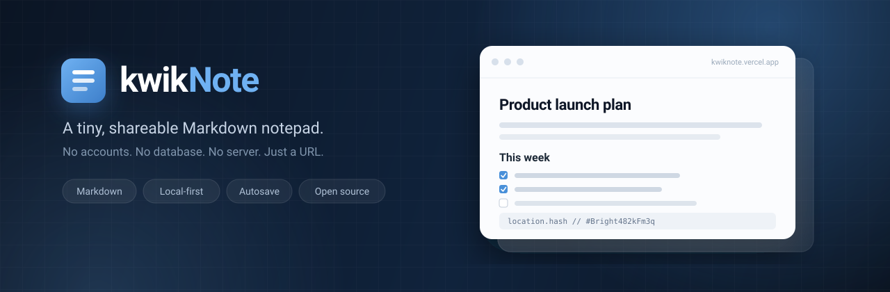
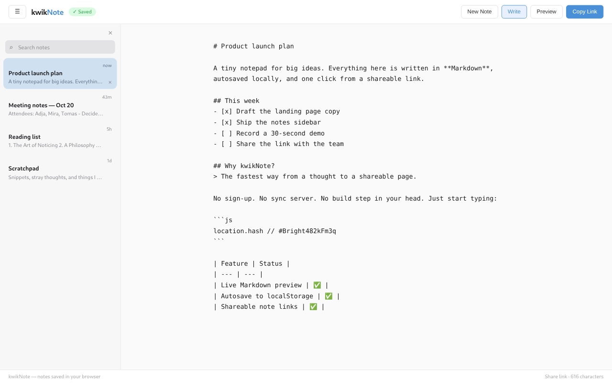
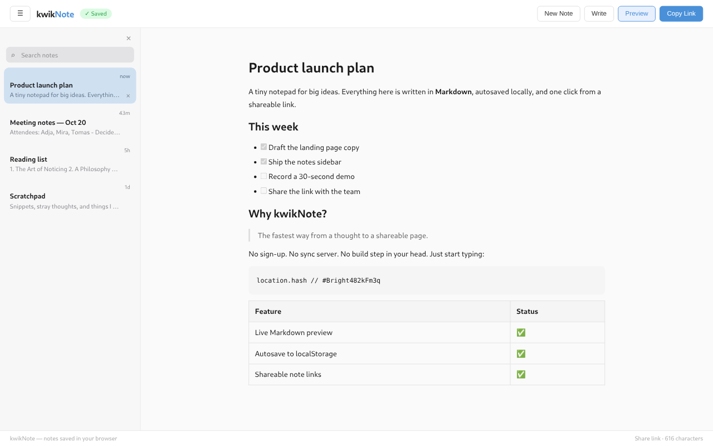

<div align="center">



<br />

<a href="https://kwiknote.vercel.app"></a>
<a href="https://github.com/Djadweb/kwikNote/actions/workflows/ci.yml"></a>


<br /><br />

**A tiny, shareable Markdown notepad that lives in your browser.**

No account. No database. No server. Open it, write, and your note is there the next time you come back.

[Live demo](https://kwiknote.vercel.app) · [Features](#features) · [Quick start](#quick-start) · [How it works](#how-it-works) · [Contributing](#contributing)

</div>

---

kwikNote is a local-first notepad built with React and Vite. Type Markdown, flip to a clean preview, and keep multiple notes in a searchable sidebar. Notes autosave to `localStorage` as you type, and every note gets a readable URL such as `#Bright482kFm3q`.

It is intentionally small: no sign-up wall, no analytics, no backend to run, and no build step between you and a thought.

## Features

- **Markdown editor with a one-click preview** — GitHub-flavored Markdown including tables, task lists, code blocks, blockquotes, and images.
- **Autosave that stays out of the way** — edits are persisted after a 400 ms debounce, with a `Saved` indicator in the toolbar.
- **A notes sidebar** — search across titles and previews, see relative timestamps, and delete notes from the row.
- **URL-based notes** — each note has a human-readable ID used for deep links and `Copy Link`.
- **Markdown-aware editing** — pressing Enter continues bullet and numbered lists, and increments ordered markers.
- **Local-first and static** — notes never leave the browser; the app is plain HTML, CSS, and JavaScript.
- **Small surface area** — one component, a few pure helpers, and a test suite around both.

## Screenshots

| Write | Preview |
| :---: | :---: |
|  |  |

> **A note about links:** kwikNote has no sync server, so a note link does not transfer note content between devices. The hash identifies a note inside the browser where it was created. `Copy Link` is a convenient deep link and bookmark, not cross-device sharing.

## Quick start

```bash
git clone https://github.com/Djadweb/kwikNote.git
cd kwikNote
npm install
npm run dev
```

Open <http://localhost:5173>. A note ID is generated automatically; start typing.

### Scripts

| Command | What it does |
| --- | --- |
| `npm run dev` | Start the Vite development server |
| `npm run build` | Build a production bundle into `dist/` |
| `npm run preview` | Serve the production build locally |
| `npm test` | Run the Vitest suite once |

## How it works

There is no API and no database. The URL hash is the note ID, and the browser is the store:

```text
URL hash  #Bright482kFm3q
              │
              ▼
localStorage["kwiknote:Bright482kFm3q"]
```

Two keys are written per note:

| Key | Value |
| --- | --- |
| `kwiknote:<id>` | Markdown source |
| `kwiknote:meta:<id>` | Last-saved timestamp in milliseconds |

On load, the app reads the ID from `location.hash` (or generates a new one), restores the note, and scans `localStorage` to build the sidebar. IDs are generated from an adjective, a three-digit number, and five random characters.

### Project structure

```text
src/
  App.jsx          editor, preview, toolbar, and notes sidebar
  lib.js           pure helpers: IDs, storage, titles, previews
  lib.test.js      unit tests for the helpers
  App.test.jsx     component and interaction tests
  main.jsx         React entry point
  styles.css       the entire design system, no CSS framework
public/
  favicon.svg      the note mark
docs/
  banner.svg       README banner
  screenshot-*.png
```

### Testing

```bash
npm test
```

The suite uses Vitest with jsdom and Testing Library. It covers ID generation, storage behavior, title/preview extraction, autosave debounce, navigation, search, and Markdown preview.

### Deployment

kwikNote is a static site. The included `vercel.json` builds with `vite build` and publishes `dist/`. Any static host works:

```bash
npm run build
# serve dist/ with your host of choice
```

## Known limitations

- **Notes are per-browser.** Clearing site data, using private mode, or switching devices means starting fresh. There is no sync or account layer.
- **Links are identifiers, not payloads.** See the note under [Screenshots](#screenshots).
- **No export/import yet.** Markdown can be copied out of the editor, but there is no bulk export.

## Roadmap

Ideas that fit the project's small, local-first spirit:

- [ ] Export and import notes as Markdown or JSON
- [ ] Optional end-to-end encrypted sync
- [ ] Theme and typography controls
- [ ] Installable PWA with an offline shell

Have a better idea? Open an issue and make the case.

## Contributing

Contributions of every size are welcome — bug reports, docs fixes, tests, and small features. Please read [CONTRIBUTING.md](CONTRIBUTING.md) before opening a pull request, and keep the project's constraints in mind:

- No backend, accounts, or tracking.
- Keep the dependency list short.
- Put logic in `lib.js` and cover it with a test.
- Run `npm test` and `npm run build` before pushing.

By participating, you agree to follow the [Code of Conduct](CODE_OF_CONDUCT.md).

## License

Released under the [ISC License](LICENSE).

<div align="center">
  <sub>Built with React and Vite. If kwikNote saves you a few seconds, consider starring the repo.</sub>
</div>
